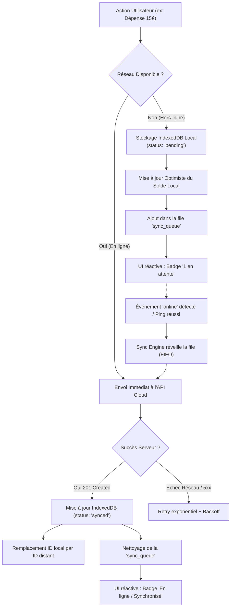

# 📱 Architecture Cloud & Offline-First Sync — SmartWallet (Vaultis)

> **Document d'Architecture Système & Planification Stratégique**  
> **Auteur :** Architecte Cloud, Backend & Offline-First  
> **Projet :** SmartWallet (`smart-wallet-api` & `smart-wallet-ui`)  
> **Objectif :** Permettre l'usage quotidien nomade sur smartphone avec ou sans connexion 4G, synchronisation automatique en ligne, hébergement Cloud 100% gratuit ($0/mois).

---

## 1. 🔍 Diagnostic de l'Architecture Actuelle

### 1.1 Composants Existants
* **Frontend :** React 19 + TypeScript + Vite + Tailwind CSS v4 (`smart-wallet-ui`).
* **Backend :** Spring Boot 3 (Java 17/21) exposé sur le port `8081` (`smart-wallet-api`).
* **Base de données :** MySQL local sur `localhost:3306` (`smartwallet_db`).
* **Proxy de dev :** Vite redirige `/api` vers `http://localhost:8081`.

### 1.2 Pourquoi cette architecture échoue sur Mobile Nomade
1. **Le piège du `localhost` :**
   * Sur un smartphone, `localhost` (ou `127.0.0.1`) pointe vers la boucle locale du téléphone lui-même, et non vers l'ordinateur portable de développement.
2. **Dépendance au réseau Wi-Fi local :**
   * Même en configurant l'IP locale de la machine (`192.168.x.x`), dès que l'utilisateur quitte son domicile (taxi, supermarché, métro, rue), le smartphone bascule sur le réseau 4G/5G. L'IP locale devient inaccessible.
3. **Machine hôte requise :**
   * Si le PC portable est éteint, en veille ou déconnecté du Wi-Fi, le backend Spring Boot s'arrête instantanément.
4. **Absence de persistance locale dans le Frontend :**
   * Actuellement, `smart-wallet-ui` ne stocke dans `localStorage` que le jeton JWT (`token`).
   * Aucune transaction, aucun historique ni solde n'est persisté hors mémoire vive. Une coupure réseau dans un magasin affiche une page blanche ou des erreurs d'échec API.

---

## 2. ☁️ Benchmark des Solutions Cloud 100% Gratuites ($0/mois)

Voici l'analyse comparative des 3 options viables pour faire tourner l'infrastructure sans débourser un centime :

| Critères | Option 1 : Spring Boot Cloud + DB Gratuite | Option 2 : Serverless BaaS (Supabase) | Option 3 : Auto-Hébergement + Cloudflare Tunnel |
| :--- | :--- | :--- | :--- |
| **Composants** | Render/Koyeb (Spring) + TiDB Serverless (MySQL) | Supabase (Postgres + Auth + REST API) | PC Allumé H24 + Docker + `cloudflared` |
| **Coût Réel** | **0,00 $ / mois** | **0,00 $ / mois** (Tier gratuit à vie) | **0,00 $ / mois** (hors électricité PC) |
| **Temps de Réveil (Cold Start)** | ⚠️ **45 à 90 secondes** (mise en veille Render) | ⚡ **0 seconde** (Instant & Always-On) | ⚡ **0 seconde** (tant que le PC tourne) |
| **Consommation Mémoire** | ~350-450 Mo RAM (limite free tier = 512 Mo) | Géré et optimisé par Supabase | Selon le PC local |
| **Maintenance Serveur** | Élevée (CI/CD conteneurs, JVM, logs, crash) | Nulle (BaaS managé, sauvegardes auto) | Moyenne (PC doit rester sous tension) |
| **Adaptabilité Offline-First** | Nécessite des endpoints de synchronisation batch | Excellente compatibilité REST / Sync | Nécessite des endpoints de synchronisation batch |
| **Expérience Utilisateur Mobile** | Frustrante au réveil (lenteur à la 1re requête) | Fluide, réactive, instantanée | Risque d'indisponibilité si coupure maison |

---

### Détail des Options :

#### 🔹 Option 1 : Conserver le Backend Spring Boot en Cloud Gratuit
* **Hébergeur API Java :**
  * **Render.com** (Free Web Service) ou **Koyeb** (Micro Instance 512 Mo RAM).
  * *Contrainte majeure :* Les instances gratuites s'endorment après 15 minutes d'inactivité. Un redémarrage Spring Boot (JVM + Hibernate + Flyway/DDL) met entre **50 et 80 secondes**. Si l'utilisateur sort son téléphone pour enregistrer une dépense de café, attendre 1 minute est rédhibitoire.
  * *Contournement possible :* Configurer un ping de monitoring gratuit (ex: Cron-Job.org ou UptimeRobot) toutes les 10 minutes sur `/actuator/health` pour empêcher l'endormissement.
* **Base de données MySQL Gratuite :**
  * **TiDB Serverless Cloud :** 5 Go gratuits à vie, 100% compatible MySQL 8.0, haute disponibilité, hébergé sur AWS/GCP.
  * Alternative : **Aiven MySQL Free Tier** ou **Supabase Postgres** (en adaptant le dialecte JPA Hibernate).

#### 🔹 Option 2 (Recommandée pour la fiabilité & vélocité) : Transition Serverless / Supabase
* **Pourquoi c'est l'option idéale pour un usage mobile nomade :**
  * **PostgreSQL managé 500 Mo** gratuit à vie (soit plus de 500 000 transactions financières).
  * **API REST PostgREST automatique :** Aucun code boilerplate Java de contrôleurs/repositories à maintenir.
  * **Row-Level Security (RLS) :** Sécurisation native au niveau de la base de données. Chaque utilisateur ne peut lire et modifier que son propre portefeuille et ses transactions.
  * **Authentification prête à l'emploi :** JWT sécurisé, tokens de rafraîchissement automatiques gérés par le SDK Supabase.
  * **Cold Start nul :** L'API Edge répond en moins de 50 ms en permanence.
  * **Zero maintenance :** Plus de serveur Java qui crash ou consomme 500 Mo de RAM.

#### 🔹 Option 3 : Passerelle Cloudflare Tunnel (Hybride)
* Utilisation de l'outil gratuit `cloudflared` sur le PC de dev qui expose un nom de domaine sécurisé HTTPS (ex: `https://wallet-api.mondomaine.com`) vers `localhost:8081`.
* *Verdict :* Intéressant uniquement pour tester rapidement sur téléphone pendant le dev à la maison, mais **inadapté pour la production quotidienne**, car l'application s'arrête dès que le PC est éteint, fermé ou en veille.

---

## 3. 📲 Architecture "Offline-First" sur Smartphone

Pour garantir que l'utilisateur puisse ajouter une dépense dans un parking souterrain, un avion ou un taxi sans 4G, l'application doit être conçue en **Offline-First**.

### 3.1 Stockage Local Embarqué : IndexedDB via Dexie.js
Au lieu du simple `localStorage` (qui est synchrone, bloquant et limité à 5 Mo), nous utilisons **IndexedDB** piloté par **Dexie.js** :
* **Asynchrone et non-bloquant** pour l'interface graphique 60fps.
* **Capacité :** Jusqu'à plusieurs gigaoctets sur mobile.
* **Schéma local typé :**
  * `local_transactions` : toutes les transactions avec drapeau `syncStatus: 'synced' | 'pending' | 'failed'`.
  * `local_wallet` : solde du portefeuille en cache avec calcul local prédictif.
  * `sync_queue` : file d'attente des opérations à rejouer dès le retour du réseau.

```typescript
// Structure des données locales (Dexie.js)
export interface OfflineTransaction {
  id: string; // UUID local v4
  amount: number;
  type: 'DEBIT' | 'CREDIT';
  category: string;
  description: string;
  timestamp: string; // ISO 8601 UTC
  syncStatus: 'synced' | 'pending' | 'failed';
}

export interface SyncOperation {
  id: string; // UUID de l'opération
  action: 'CREATE_EXPENSE' | 'DEPOSIT' | 'TRANSFER';
  payload: any;
  createdAt: string;
  retryCount: number;
}
```

---

### 3.2 Cycle de Synchronisation Bidirectionnelle



---

### 3.3 Résolution des Conflits & Cohérence Financière
1. **Transactions Immuables (Append-Only) :**
   * Contrairement à un document texte, une dépense financière ne s'écrase pas. C'est une écriture d'événement horodatée.
   * Chaque transaction générée hors-ligne reçoit un **UUID v4 côté client**, utilisé comme **clé d'idempotence**. Si le réseau coupe au moment de la réponse du serveur, le rejeu de l'opération ne créera jamais de transaction en doublon.
2. **Gestion du Solde (Balance Drift) :**
   * En mode hors-ligne, le solde local est débité de manière **optimiste**.
   * Au retour de la synchronisation, le serveur fait autorité sur le solde consolidé et synchronise les éventuels virements tiers reçus entre-temps.
3. **Cas du solde insuffisant lors de la synchronisation :**
   * Si deux dépenses hors-ligne dépassent le solde réel, l'application applique la politique définie (ex: autorisation de découvert temporaire avec notification d'avertissement visuelle ou rejet de la transaction la plus récente avec notification explicite).

---

### 3.4 Transformation PWA (Progressive Web App)
Pour que l'application s'installe sur smartphone sans passer par l'App Store ou le Play Store :
* Intégration de `vite-plugin-pwa` avec **Service Worker (Workbox)**.
* Mise en cache complète du shell applicatif (HTML, CSS, JS, Fonts Instrument Serif / Inter).
* L'application s'ouvre **instantanément en mode avion**, sans écran blanc.
* Affichage en mode `standalone` (sans barre d'adresse navigateur, look 100% natif avec icône sur l'écran d'accueil).

---

## 4. 🧭 Recommandation d'Orientation pour l'Utilisateur

Deux voies architecturales sont proposées :

### Option A : Solution Serverless Cloud Pure (Supabase + PWA Dexie.js) ⭐ RECOMMANDÉE
* **Avantages :** Zéro serveur Java à héberger, 0 seconde de cold start, fiabilité 99.9% gratuite à vie, réactivité totale sur smartphone.
* **Effort :** Remplacement de la couche de communication Axios par le client Supabase (tables `users`, `wallets`, `transactions`).
* **Coût :** **0,00 $ à vie**.

### Option B : Solution Spring Boot Préservée (Render/Koyeb + TiDB + Keep-Alive Cron)
* **Avantages :** 100% du code Java / Spring Boot existant est conservé.
* **Inconvénients :** Nécessite la configuration d'un ping toutes les 10 min (UptimeRobot) pour éviter le cold start de 60s, et hébergement de la DB sur TiDB Cloud.
* **Coût :** **0,00 $**.

---

## 5. 📋 Prochaines Étapes Validables

1. **Validation du choix d'hébergement :**
   * *Choix A :* Supabase (performances maximales sur smartphone, 0 maintenance).
   * *Choix B :* Spring Boot Dockerisé sur Render/Koyeb + TiDB Serverless.
2. **Implémentation de la couche Offline-First UI :**
   * Installation de `dexie` et `dexie-react-hooks`.
   * Création du `SyncManager` et de la `sync_queue`.
   * Intégration du composant visuel `SyncIndicator` (badge En ligne / Hors-ligne).
3. **Activation PWA :**
   * Ajout de `vite-plugin-pwa`, création du manifeste et des icônes d'application mobile.
