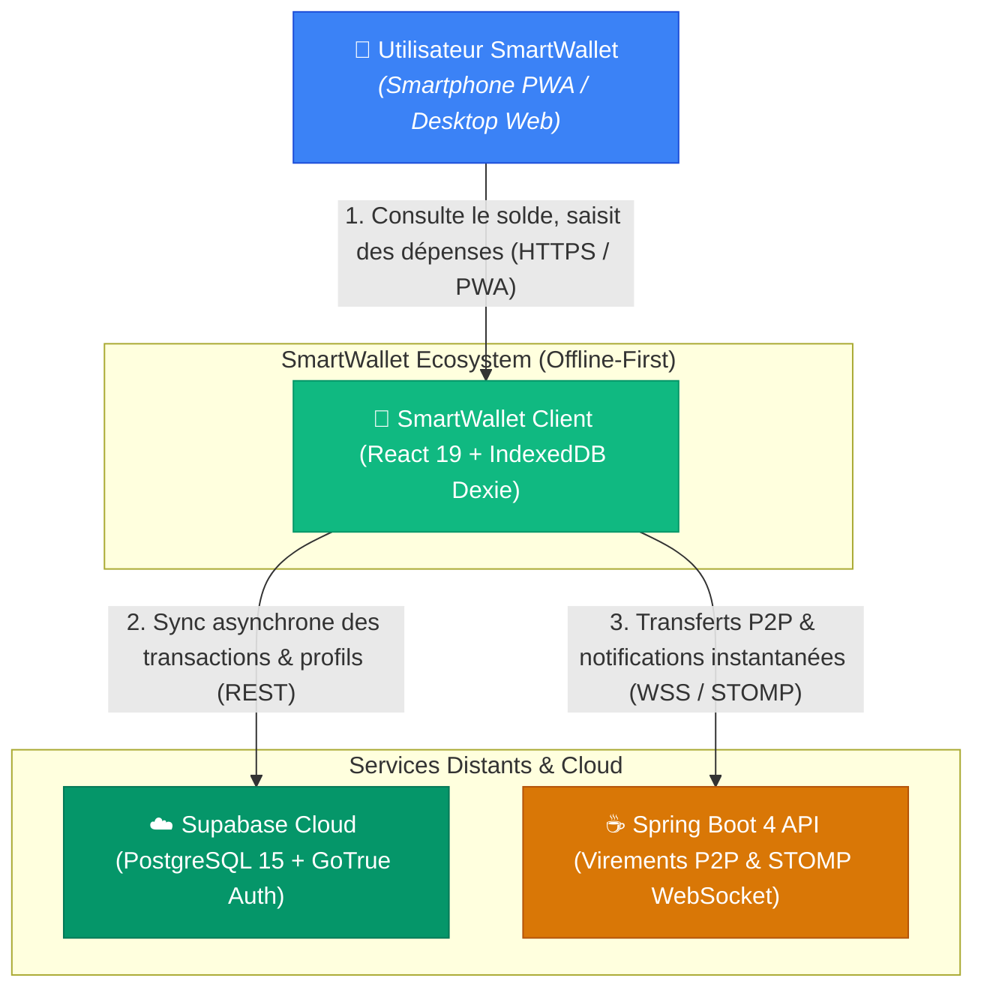
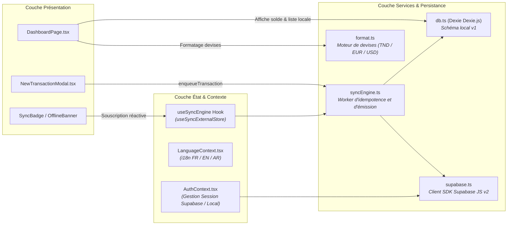
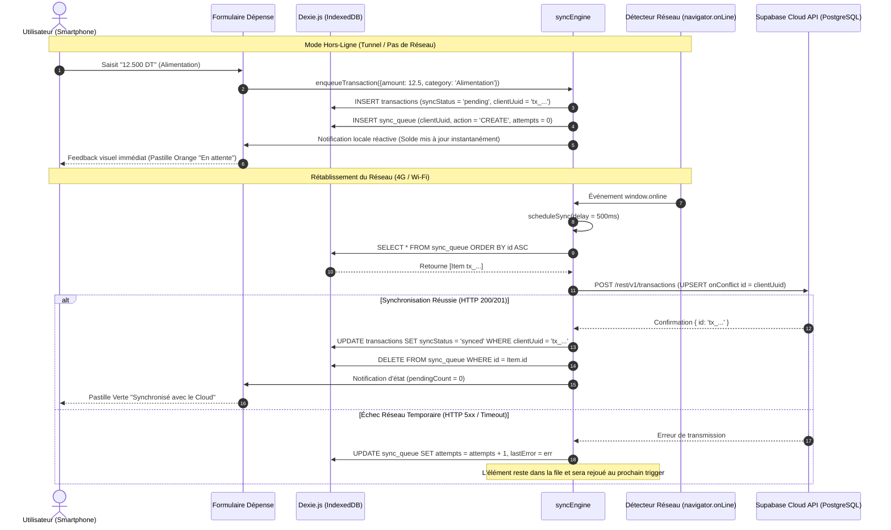

# 🏗 Architecture Système — SmartWallet (Vaultis)

> **Document de Référence Technique & Architecture C4**  
> **Version :** 2.0.0 (Production Ready)  
> **Date de révision :** Octobre 2026  
> **Statut :** Approuvé pour exploitation réelle

---

## 1. 🌐 Vue d'Ensemble & Vision Stratégique

**SmartWallet** est une plateforme financière personnelle haut de gamme conçue selon le paradigme **Offline-First**. Elle permet aux utilisateurs de gérer leurs portefeuilles, enregistrer leurs dépenses et consulter leurs soldes dans des conditions réseau hostiles ou inexistantes (parkings souterrains, transports, zones blanches 4G/5G), tout en assurant une réconciliation automatique et idempotente dès la restauration de la connectivité.

### Piliers Architecturaux

1. **Zéro Cold-Start ($0/mois) :** Découplage de la dépendance à un serveur applicatif lourd grâce à une architecture serverless hybride avec **Supabase Cloud** (PostgreSQL managé + Auth + REST Edge) sans temps de réveil.
2. **Offline-First & Local-First :** Persistance locale complète dans le navigateur client via **IndexedDB** piloté par **Dexie.js**. L'interface réagit en temps réel (< 16ms, 60 FPS) sans jamais bloquer sur une requête réseau.
3. **Idempotence & Intégrité Transactionnelle :** Chaque transaction génère un `clientUuid` unique dès sa saisie locale. La synchronisation distante utilise un mécanisme d'insertion conditionnelle (*Upsert*) garantissant l'absence de doublons, même en cas de rejeux répétés.
4. **Précision Financière Stricte :** Support natif du Dinar Tunisien (**TND**) avec 3 décimales obligatoires (millimes) et calculs financiers protégés contre les erreurs d'arrondi à virgule flottante IEEE 754.

---

## 2. 🏛 Modèle C4 (Context, Container, Component)

Le modèle C4 structure la compréhension du système à différents niveaux d'abstraction.

### 2.1 Niveau 1 : Diagramme de Contexte Système (C4 Context)

Ce diagramme présente les utilisateurs finaux et les systèmes externes interagissant avec SmartWallet.



---

### 2.2 Niveau 2 : Diagramme de Conteneurs (C4 Container)

Ce diagramme détaille les conteneurs applicatifs et de données qui composent la solution.

```mermaid
graph TD
    subgraph Client["Poste Client (Navigateur Web / PWA Mobile)"]
        UI["SPA React 19 + TypeScript + Vite<br/><i>Tailwind CSS v4 & Lucide Icons</i>"]
        Engine["syncEngine.ts<br/><i>Orchestrateur asynchrone d'état & réseau</i>"]
        IDB[("IndexedDB (Dexie.js)<br/><i>Tables : transactions, wallet, sync_queue</i>")]
        UI -->|Lecture / Écriture locale instantanée| IDB
        UI -->|Écoute l'état de synchronisation| Engine
        Engine -->|Lit la file d'attente (FIFO) & met à jour le statut| IDB
    end

    subgraph Cloud["Supabase Cloud (Tier $0/mois Always-On)"]
        GoTrue["GoTrue Auth<br/><i>Authentification JWT, Sessions persistantes</i>"]
        PostgREST["PostgREST Edge Engine<br/><i>Exposition REST instantanée</i>"]
        PgDB[("PostgreSQL 15 Managé<br/><i>RLS multi-tenant, Triggers, Profils, Wallets</i>")]
        PostgREST --> PgDB
        GoTrue --> PgDB
    end

    subgraph EnterpriseBackend["Spring Boot API (Conteneur Optionnel)"]
        Boot["Spring Boot 4 / Java 21<br/><i>Security JWT, Controllers REST, Services</i>"]
        SockBroker["STOMP Broker WebSocket<br/><i>Canal /topic/wallet/{username}</i>"]
        MySQL[("Base MySQL / TiDB<br/><i>Persistance relationnelle</i>")]
        Boot --> MySQL
        SockBroker --> Boot
    end

    Engine -.->|Sync HTTP POST/PUT (REST)| PostgREST
    UI -.->|Login / Register (JWT)| GoTrue
    UI -.->|Transferts P2P / REST| Boot
    UI -.->|Souscription temps réel| SockBroker

    style Client fill:#1e293b,stroke:#0ea5e9,stroke-width:2px,color:#fff
    style Cloud fill:#0f172a,stroke:#10b981,stroke-width:2px,color:#fff
    style EnterpriseBackend fill:#1e1e2e,stroke:#f59e0b,stroke-width:2px,color:#fff
```

---

### 2.3 Niveau 3 : Diagramme de Composants Frontend (C4 Component)

Structure modulaire du client React 19 et flux de dépendances internes :



---

## 3. 🔄 Modèle de Synchronisation Offline-First

Le cœur du système repose sur une stratégie **Local-First avec synchronisation différée**.

### 3.1 Idempotence via `clientUuid`

Pour éliminer tout risque de double facturation ou de duplication de transaction en cas de coupure réseau pendant une requête HTTP :
1. Dès que l'utilisateur valide le formulaire, le client génère un identifiant unique universel :
   ```typescript
   const clientUuid = `tx_${Date.now()}_${Math.random().toString(36).substring(2, 9)}`;
   ```
2. Cet identifiant sert à la fois de clé primaire locale dans IndexedDB et de clé primaire `id` (de type `TEXT`) dans la table Postgres distante `public.transactions`.
3. L'envoi distant est exécuté via un `UPSERT` avec clause conflictuelle :
   ```sql
   INSERT INTO public.transactions (id, user_id, amount, type, category, ...)
   VALUES (:clientUuid, :userId, :amount, :type, :category, ...)
   ON CONFLICT (id) DO UPDATE SET timestamp = EXCLUDED.timestamp;
   ```
4. Si le paquet réseau est transmis mais que la réponse HTTP est perdue (timeout client), le rejeu ultérieur par `syncEngine` n'insère aucun doublon : il effectue une mise à jour transparente sans modifier les données comptables.

---

### 3.2 File d'Attente FIFO (`sync_queue`)

La table locale `sync_queue` stocke les actions en attente de synchronisation avec les propriétés suivantes :

| Champ | Type Dexie | Rôle technique |
| :--- | :--- | :--- |
| `id` | `number` (auto-incrément) | Ordre strict d'exécution FIFO (`orderBy('id')`) |
| `clientUuid` | `string` | Identifiant d'idempotence de la transaction liée |
| `action` | `'CREATE' \| 'UPDATE' \| 'DELETE'` | Type d'opération à exécuter |
| `entity` | `'transaction' \| 'wallet'` | Cible du modèle |
| `payload` | `Record<string, unknown>` | Données complètes de l'opération |
| `createdAt` | `string` (ISO 8601) | Timestamp d'enregistrement local |
| `attempts` | `number` | Compteur d'essais pour gestion du backoff |
| `lastError` | `string \| null` | Dernier message d'erreur réseau / serveur |

---

### 3.3 Cycle de Vie d'une Transaction (Diagramme de Séquence)

Ce diagramme illustre le parcours complet d'une dépense saisie hors-ligne, stockée localement, puis synchronisée lors du retour de la connectivité.



---

## 4. ⚖️ Stratégie de Résolution des Conflits

Dans une architecture multi-appareils (ex: saisie sur smartphone et consultation sur tablette), les règles de conflit suivantes s'appliquent :

1. **Transactions Financières (Modèle Append-Only) :**
   * *Règle :* **Aucun conflit structurel.** Les transactions sont des événements immuables dans un journal comptable (ledger). Chaque dépense possède son propre `clientUuid`. Deux dépenses créées simultanément sur deux appareils différents s'ajoutent toutes deux au grand livre.
2. **Solde du Portefeuille (Calcul Dérivé vs Stocké) :**
   * *Règle :* Le solde distant dans `public.wallets` est recalculé ou ajusté par trigger SQL atomique. En local, le solde prédictif est calculé par somme cumulée des transactions locales.
3. **Profil Utilisateur & Paramètres (Last-Write-Wins - LWW) :**
   * *Règle :* Le timestamp UTC `updated_at` fait foi. La modification la plus récente écrase la précédente en cas de modification concurrente du nom ou de l'avatar.

---

## 5. 🛡 Exigences Non-Fonctionnelles & Sécurité

* **Chiffrement en Transit :** TLS 1.3 obligatoire sur l'ensemble des communications (Supabase REST et Spring Boot).
* **Isolation Multi-Tenant :** RLS (Row Level Security) activé sur PostgreSQL. Il est mathématiquement impossible pour l'utilisateur $A$ de lire ou altérer les données de l'utilisateur $B$, même en altérant les requêtes HTTP côté client.
* **Résilience PWA :** Service Worker configuré pour mettre en cache l'ensemble des assets statiques (HTML, CSS, JS, polices, icônes) via stratégie *Cache-First* ou *Stale-While-Revalidate*, assurant une ouverture de l'application en moins de 200 ms sans réseau.
