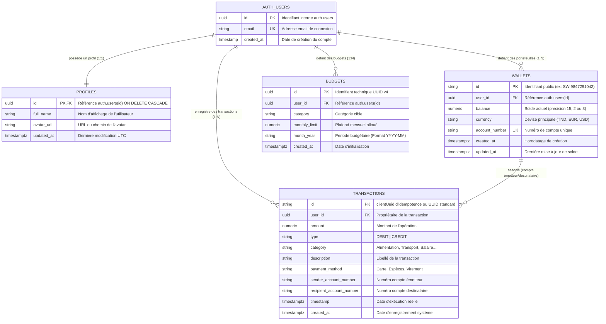
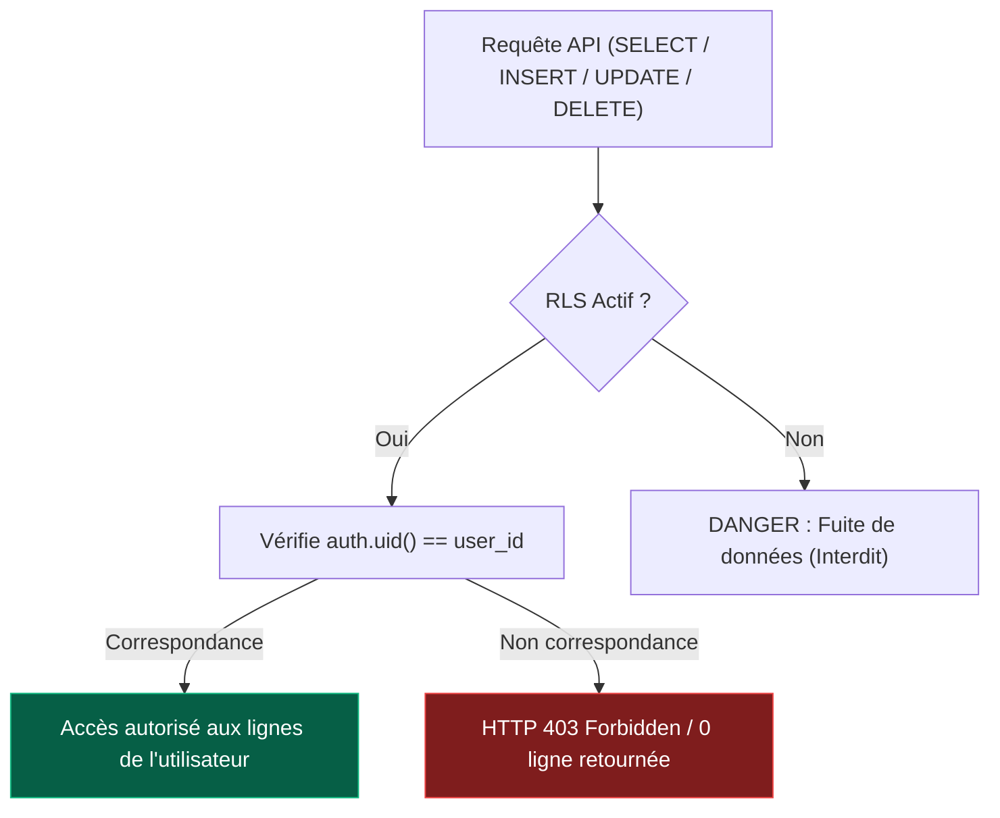
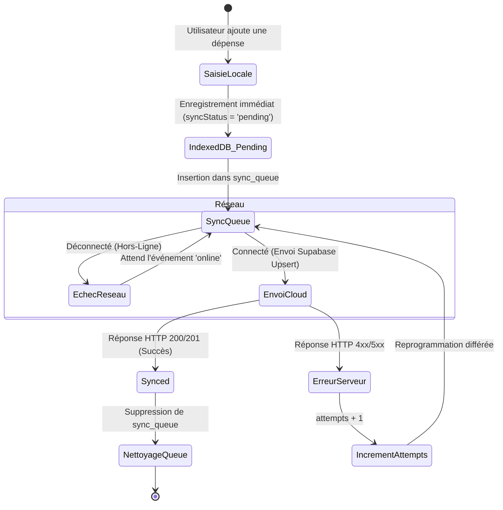

# 🗄 Spécification de la Base de Données — SmartWallet

> **Modèle Relationnel, Persistance Locale IndexedDB & Sécurité RLS**  
> **Version :** 2.0.0  
> **Moteurs de persistance :** PostgreSQL 15 (Supabase Cloud) & IndexedDB (Dexie.js Client)

---

## 1. 📊 Diagramme Entité-Association Global (ERD Mermaid)

Le diagramme ci-dessous illustre la structure des données distantes dans PostgreSQL (Supabase) ainsi que la relation avec la persistance locale du navigateur.



---

## 2. 🗃 Schéma Relationnel Cloud (PostgreSQL / Supabase)

Toutes les tables cloud sont stockées dans le schéma `public` et sont soumises à la sécurité RLS.

### 2.1 Table `public.profiles`
Stocke les données personnelles de l'utilisateur en miroir direct de l'authentification `auth.users`.

```sql
CREATE TABLE IF NOT EXISTS public.profiles (
    id UUID PRIMARY KEY REFERENCES auth.users(id) ON DELETE CASCADE,
    full_name TEXT,
    avatar_url TEXT,
    updated_at TIMESTAMP WITH TIME ZONE DEFAULT TIMEZONE('utc'::text, NOW()) NOT NULL
);
```

### 2.2 Table `public.wallets`
Gère le compte de monnaie électronique de l'utilisateur.

```sql
CREATE TABLE IF NOT EXISTS public.wallets (
    id TEXT PRIMARY KEY DEFAULT ('SW-' || floor(random() * 9000000000 + 1000000000)::text),
    user_id UUID NOT NULL REFERENCES auth.users(id) ON DELETE CASCADE,
    balance NUMERIC(15, 2) NOT NULL DEFAULT 0.00,
    currency VARCHAR(10) NOT NULL DEFAULT 'EUR',
    account_number TEXT UNIQUE,
    created_at TIMESTAMP WITH TIME ZONE DEFAULT TIMEZONE('utc'::text, NOW()) NOT NULL,
    updated_at TIMESTAMP WITH TIME ZONE DEFAULT TIMEZONE('utc'::text, NOW()) NOT NULL
);
```

### 2.3 Table `public.transactions`
Grand livre comptable des débits et crédits. La clé primaire est de type `TEXT` pour accepter indifféremment les UUIDs serveurs ou les identifiants d'idempotence générés côté client (`clientUuid`).

```sql
CREATE TABLE IF NOT EXISTS public.transactions (
    id TEXT PRIMARY KEY,
    user_id UUID REFERENCES auth.users(id) ON DELETE CASCADE,
    amount NUMERIC(15, 2) NOT NULL,
    type VARCHAR(20) NOT NULL CHECK (type IN ('DEBIT', 'CREDIT')),
    category VARCHAR(50) NOT NULL DEFAULT 'AUTRE',
    description TEXT,
    payment_method VARCHAR(50) DEFAULT 'Carte',
    sender_account_number TEXT,
    recipient_account_number TEXT,
    timestamp TIMESTAMP WITH TIME ZONE DEFAULT TIMEZONE('utc'::text, NOW()) NOT NULL,
    created_at TIMESTAMP WITH TIME ZONE DEFAULT TIMEZONE('utc'::text, NOW()) NOT NULL
);
```

### 2.4 Table `public.budgets`
Permet la fixation et le suivi des plafonds de dépenses mensuels par catégorie.

```sql
CREATE TABLE IF NOT EXISTS public.budgets (
    id UUID PRIMARY KEY DEFAULT uuid_generate_v4(),
    user_id UUID NOT NULL REFERENCES auth.users(id) ON DELETE CASCADE,
    category VARCHAR(50) NOT NULL,
    monthly_limit NUMERIC(15, 2) NOT NULL DEFAULT 500.00,
    month_year VARCHAR(10) NOT NULL, -- Format: YYYY-MM
    created_at TIMESTAMP WITH TIME ZONE DEFAULT TIMEZONE('utc'::text, NOW()) NOT NULL,
    UNIQUE(user_id, category, month_year)
);
```

---

## 3. 🔐 Politiques de Sécurité RLS (Row Level Security)

Pour garantir une isolation multi-tenant parfaite, chaque ligne de la base de données est filtrée au niveau du moteur Postgres par rapport au JWT de l'utilisateur connecté (`auth.uid()`).



### 3.1 Règles Actives
* **Activation globale :**
  ```sql
  ALTER TABLE public.profiles ENABLE ROW LEVEL SECURITY;
  ALTER TABLE public.wallets ENABLE ROW LEVEL SECURITY;
  ALTER TABLE public.transactions ENABLE ROW LEVEL SECURITY;
  ALTER TABLE public.budgets ENABLE ROW LEVEL SECURITY;
  ```
* **Profiles :**
  * `SELECT`, `INSERT`, `UPDATE` autorisés si `auth.uid() = id`.
* **Wallets :**
  * `SELECT`, `INSERT`, `UPDATE` autorisés si `auth.uid() = user_id`.
* **Transactions :**
  * `SELECT`, `INSERT`, `UPDATE` autorisés si `auth.uid() = user_id OR user_id IS NULL` (permet le fonctionnement de démonstration hors connexion).
* **Budgets :**
  * `ALL` (CRUD complet) autorisé si `auth.uid() = user_id`.

---

## 4. ⚡ Déclencheurs & Procédures Stockées (Triggers)

Pour automatiser l'onboarding et garantir l'intégrité sans code backend intermédiaire :

### Trigger `on_auth_user_created`
Lorsqu'un utilisateur s'enregistre via Supabase Auth (`auth.users`), cette procédure stockée s'exécute automatiquement en mode `SECURITY DEFINER` :
1. Crée un profil dans `public.profiles` en récupérant `full_name` et `avatar_url` des métadonnées du token.
2. Crée un portefeuille dans `public.wallets` avec un numéro de compte unique préfixé `SW-` et un solde initial de bienvenue de `1000.00 EUR`.

```sql
CREATE OR REPLACE FUNCTION public.handle_new_user()
RETURNS TRIGGER AS $$
BEGIN
    INSERT INTO public.profiles (id, full_name, avatar_url)
    VALUES (
        NEW.id,
        COALESCE(NEW.raw_user_meta_data->>'full_name', NEW.email),
        NEW.raw_user_meta_data->>'avatar_url'
    );

    INSERT INTO public.wallets (user_id, balance, currency, account_number)
    VALUES (
        NEW.id,
        1000.00,
        'EUR',
        'SW-' || floor(random() * 9000000000 + 1000000000)::text
    );

    RETURN NEW;
END;
$$ LANGUAGE plpgsql SECURITY DEFINER;

CREATE TRIGGER on_auth_user_created
    AFTER INSERT ON auth.users
    FOR EACH ROW EXECUTE FUNCTION public.handle_new_user();
```

---

## 5. 📱 Persistance Locale Client (IndexedDB via Dexie.js)

Le client web et mobile utilise **Dexie.js** (`SmartWalletDB`, version 1) pour maintenir une copie locale intégrale et opérer hors-ligne.

### 5.1 Tables IndexedDB et Indexations

```typescript
this.version(1).stores({
  transactions: '++id, remoteId, timestamp, type, category, syncStatus, clientUuid, localCreatedAt',
  wallet: 'id, updatedAt',
  sync_queue: '++id, clientUuid, action, entity, createdAt, attempts',
  user_settings: 'key',
});
```

### 5.2 Spécification des Modèles TypeScript Locaux

#### Table `transactions` (`LocalTransaction`)
```typescript
export interface LocalTransaction {
  id?: number | string;               // Clé primaire locale auto-incrémentée
  remoteId?: string | number | null;  // Identifiant distant Supabase/API
  amount: number;                     // Valeur numérique flottante
  type: 'DEBIT' | 'CREDIT';           // Nature de la transaction
  category?: string | null;           // Ex: 'Alimentation', 'Transport', etc.
  description?: string | null;        // Note textuelle utilisateur
  timestamp: string;                  // Date ISO 8601 de l'opération
  paymentMethod?: string | null;      // Mode de paiement utilisé
  syncStatus: 'synced' | 'pending' | 'failed'; // Statut de réconciliation
  localCreatedAt: string;             // Date d'enregistrement dans le navigateur
  senderAccountNumber?: string | null;
  recipientAccountNumber?: string | null;
  clientUuid?: string;                // Clé d'idempotence unique universelle
}
```

#### Table `wallet` (`LocalWallet`)
```typescript
export interface LocalWallet {
  id: string;        // Numéro de compte SW-XXXXXXXXXX
  balance: number;   // Solde local prédictif
  currency: string;  // Devise active (TND, EUR, USD)
  updatedAt: string; // Timestamp ISO 8601
}
```

#### Table `sync_queue` (`SyncQueueItem`)
```typescript
export interface SyncQueueItem {
  id?: number;                         // Ordre FIFO auto-incrémenté
  clientUuid: string;                  // Référence d'idempotence
  action: 'CREATE' | 'UPDATE' | 'DELETE';
  entity: 'transaction' | 'wallet';
  payload: Record<string, unknown>;    // Snapshot complet des données
  createdAt: string;                   // Date de mise en file
  attempts: number;                    // Nombre de tentatives d'envoi infructueuses
  lastError?: string | null;           // Rapport d'erreur HTTP ou réseau
}
```

#### Table `user_settings` (`UserSetting`)
```typescript
export interface UserSetting {
  key: string;       // Clé unique (ex: 'theme', 'language', 'currency')
  value: unknown;    // Valeur typée ou objet JSON
}
```

---

## 6. 🔄 Cycle de Synchronisation et États


