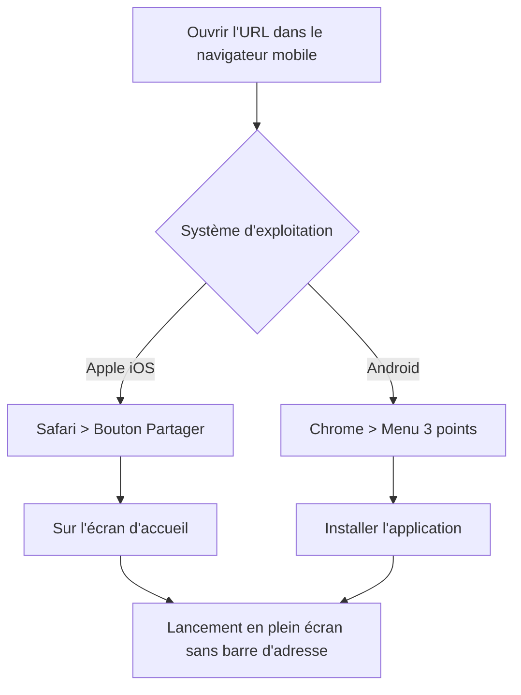

# 🚀 Guide de Déploiement & Mise en Production — SmartWallet

> **Guide Opérationnel & Procédures d'Installation**  
> **Version :** 2.0.0  
> **Environnements cibles :** Local (Dev/Test), Docker (Conteneurisé), Cloud Supabase ($0/mois), Mobile PWA (iOS/Android)

---

## 1. 📋 Prérequis Système

| Composant | Version Minimale | Rôle |
| :--- | :--- | :--- |
| **Node.js** | `v20.x` LTS ou `v22.x` | Environnement d'exécution du Frontend |
| **npm** | `v10.x` ou supérieur | Gestionnaire de dépendances frontend |
| **Java JDK** | `21` (LTS) | Compilation et exécution du backend Spring Boot |
| **Maven** | `3.9.x` (ou wrapper `./mvnw`) | Build Java / Kotlin |
| **MySQL / MariaDB** | `8.0+` / `10.5+` | Base de données relationnelle locale (si usage Spring API) |
| **Docker & Docker Compose** | `24.x+` / `v2.x+` | Déploiement conteneurisé multi-services |

---

## 2. ⚡ Déploiement Local (Développement)

SmartWallet propose deux modes d'exécution locale :
1. **Mode Serverless Autonome (Recommandé pour usage nomade direct) :** Frontend seul connecté à Supabase Cloud ou fonctionnant en pure Offline-First local via IndexedDB.
2. **Mode Full-Stack Classique :** Frontend React + Backend Spring Boot + MySQL local.

### 2.1 Lancement via Scripts Automatisés (Windows)

À la racine du projet, deux scripts batch orchestrent le cycle de vie :
```cmd
# Démarrage automatique (vérifie MySQL 3306, lance Spring Boot sur 8081, lance Vite sur 5173)
start.bat

# Arrêt propre de tous les processus orphelins (node, java, ports 5173 et 8081)
stop.bat
```

---

### 2.2 Lancement Manuel Pas-à-Pas

#### Étape A : Base de données locale (si usage Spring Boot)
1. Créez la base de données MySQL :
   ```sql
   CREATE DATABASE smartwallet_db CHARACTER SET utf8mb4 COLLATE utf8mb4_unicode_ci;
   ```
2. Vérifiez les identifiants dans `smart-wallet-api/src/main/resources/application.properties` :
   ```properties
   spring.datasource.url=jdbc:mysql://localhost:3306/smartwallet_db?useSSL=false&serverTimezone=UTC&allowPublicKeyRetrieval=true
   spring.datasource.username=root
   spring.datasource.password=
   server.port=8081
   ```

#### Étape B : Démarrage du Backend Spring Boot
```bash
cd smart-wallet-api
# Windows
.\mvnw.cmd spring-boot:run
# Linux / macOS
chmod +x mvnw && ./mvnw spring-boot:run
```
Le backend est opérationnel sur `http://localhost:8081`. L'Actuator de santé est disponible sur `http://localhost:8081/actuator/health`.

#### Étape C : Démarrage du Frontend React Vite
```bash
cd smart-wallet-ui
npm install
npm run dev
```
L'interface est accessible sur `http://localhost:5173`.

---

## 3. ☁️ Configuration Supabase Cloud Gratuite ($0/mois, 0s Cold Start)

Supabase offre une infrastructure PostgreSQL managée, une API REST haute performance (PostgREST) et une authentification sécurisée (GoTrue) sans aucun coût récurrent.


### Étape 1 : Création du Projet Supabase
1. Rendez-vous sur [https://supabase.com](https://supabase.com) et connectez-vous (via GitHub ou email).
2. Cliquez sur **"New project"**.
3. Renseignez les informations :
   * **Name :** `smart-wallet`
   * **Database Password :** Choisissez un mot de passe robuste (à conserver).
   * **Region :** Choisissez la région la plus proche de vous (ex: `eu-central-1` Francfort ou `eu-west-3` Paris).
   * **Pricing Plan :** `Free ($0 / month)`.
4. Cliquez sur **"Create new project"** (le provisionnement prend environ 60 à 90 secondes).

---

### Étape 2 : Exécution du Schéma SQL & Sécurité RLS
1. Dans le menu latéral gauche de votre tableau de bord Supabase, cliquez sur **"SQL Editor"** (icône `>_`).
2. Cliquez sur **"New query"**.
3. Ouvrez le fichier `supabase_schema.sql` situé à la racine du projet SmartWallet, copiez l'intégralité de son contenu et collez-le dans l'éditeur Supabase.
4. Cliquez sur **"Run"** (ou `Ctrl + Enter`).
5. **Résultat attendu :** Message `Success. No rows returned`. Les tables suivantes sont créées et sécurisées par Row Level Security (RLS) :
   * `public.profiles` (Profils utilisateurs liés à `auth.users`)
   * `public.wallets` (Portefeuilles monétaires avec solde initial)
   * `public.transactions` (Grand livre comptable idempotent avec support `clientUuid`)
   * `public.budgets` (Gestion des plafonds mensuels de dépenses)
   * Trigger `on_auth_user_created` (Initialisation automatique d'un compte et d'un portefeuille à l'inscription).

---

### Étape 3 : Configuration des Variables d'Environnement Frontend
1. Dans Supabase, rendez-vous dans **"Project Settings"** (icône d'engrenage en bas à gauche) > **"API"**.
2. Repérez la section **Project API keys** et **Project URL** :
   * **Project URL :** `https://xxxxxxxxxxxxxxxxxxxx.supabase.co`
   * **anon / public key :** `eyJhbGciOi...`
3. Dans le dossier `smart-wallet-ui/`, créez un fichier `.env` (en copiant `.env.example`) :
   ```env
   # Configuration Supabase Cloud
   VITE_SUPABASE_URL=https://xxxxxxxxxxxxxxxxxxxx.supabase.co
   VITE_SUPABASE_ANON_KEY=eyJhbGciOiJIUzI1NiIsInR5cCI6IkpXVCJ9.exemple_de_cle_anon

   # Configuration optionnelle API locale
   VITE_API_URL=http://localhost:8081/api
   ```
4. Relancez le serveur de développement Vite (`npm run dev`) ou recompilez (`npm run build`).

> [!TIP]
> **Mode Zéro Configuration :** Si les clés `VITE_SUPABASE_URL` et `VITE_SUPABASE_ANON_KEY` sont omises ou vides, l'application ne plante pas ! Elle bascule automatiquement en mode **Local-First Autonome** : les écritures sont stockées dans IndexedDB (`SmartWalletDB`) et seront prêtes à être envoyées dès que les clés seront renseignées.

---

## 4. 🐳 Déploiement Conteneurisé avec Docker

Pour héberger l'ensemble de l'écosystème sur un VPS, un serveur dédié ou un NAS Docker.

### 4.1 Fichier `Dockerfile` Frontend (`smart-wallet-ui/Dockerfile`)
```dockerfile
# Stage 1: Build de la SPA React
FROM node:22-alpine AS build
WORKDIR /app
COPY package*.json ./
RUN npm ci
COPY . .
RUN npm run build

# Stage 2: Serveur HTTP Nginx léger
FROM nginx:alpine
COPY --from=build /app/dist /usr/share/nginx/html
COPY nginx.conf /etc/nginx/conf.d/default.conf
EXPOSE 80
CMD ["nginx", "-g", "daemon off;"]
```

### 4.2 Fichier `Dockerfile` Backend (`smart-wallet-api/Dockerfile`)
```dockerfile
# Stage 1: Compilation Maven & JDK 21
FROM eclipse-temurin:21-jdk-alpine AS build
WORKDIR /app
COPY mvnw pom.xml ./
COPY .mvn .mvn
RUN ./mvnw dependency:go-offline -B
COPY src ./src
RUN ./mvnw clean package -DskipTests

# Stage 2: Runtime JRE 21 allégé
FROM eclipse-temurin:21-jre-alpine
WORKDIR /app
COPY --from=build /app/target/*.jar app.jar
EXPOSE 8081
ENTRYPOINT ["java", "-jar", "app.jar"]
```

### 4.3 Fichier `docker-compose.yml` (À la racine du projet)
```yaml
version: '3.8'

services:
  db:
    image: mysql:8.0
    container_name: smartwallet-mysql
    restart: always
    environment:
      MYSQL_DATABASE: smartwallet_db
      MYSQL_ROOT_PASSWORD: root_password_secr3t
    ports:
      - "3306:3306"
    volumes:
      - mysql_data:/var/lib/mysql

  api:
    build:
      context: ./smart-wallet-api
      dockerfile: Dockerfile
    container_name: smartwallet-api
    restart: always
    depends_on:
      - db
    environment:
      SPRING_DATASOURCE_URL: jdbc:mysql://db:3306/smartwallet_db?useSSL=false&serverTimezone=UTC&allowPublicKeyRetrieval=true
      SPRING_DATASOURCE_USERNAME: root
      SPRING_DATASOURCE_PASSWORD: root_password_secr3t
    ports:
      - "8081:8081"

  ui:
    build:
      context: ./smart-wallet-ui
      dockerfile: Dockerfile
    container_name: smartwallet-ui
    restart: always
    ports:
      - "80:80"
    depends_on:
      - api

volumes:
  mysql_data:
```

Lancement en une commande :
```bash
docker compose up -d --build
```

---

## 5. 📱 Installation Mobile PWA (Progressive Web App)

SmartWallet est optimisé pour une utilisation native sur smartphone, sans passer par les stores d'applications (App Store ou Google Play Store).



### 5.1 Procédure sur iOS (iPhone / iPad — Safari)

1. Ouvrez **Safari** sur votre iPhone.
2. Naviguez vers l'URL de votre application (ex: votre domaine HTTPS ou adresse locale).
3. Appuyez sur le bouton **Partager** (le carré avec une flèche pointant vers le haut, situé au centre de la barre d'outils inférieure).
4. Faites défiler les options et touchez **"Sur l'écran d'accueil"** (icône avec un `+`).
5. Nommez l'application (ex: `SmartWallet` ou `Vaultis`) et confirmez en touchant **"Ajouter"** en haut à droite.
6. **Résultat :** L'icône SmartWallet apparaît sur l'écran d'accueil de votre iPhone. Lorsqu'elle est lancée, elle s'exécute en mode autonome plein écran (*standalone*), sans les barres de navigation du navigateur.

---

### 5.2 Procédure sur Android (Google Chrome)

1. Ouvrez **Google Chrome** sur votre smartphone Android.
2. Naviguez vers l'URL de l'application.
3. Deux possibilités :
   * Une bannière d'installation s'affiche automatiquement en bas de l'écran : touchez **"Installer SmartWallet"**.
   * Ou touchez les **trois points verticaux** en haut à droite, puis sélectionnez **"Installer l'application"** (ou **"Ajouter à l'écran d'accueil"**).
4. Validez l'invite d'installation.
5. **Résultat :** L'application est installée comme une Web App progressive native, intégrée au tiroir d'applications d'Android et capable de tourner à 100% hors-ligne.

---

### 5.3 Validation du Fonctionnement Hors-Ligne (Test Terrain)

Pour vérifier la robustesse en conditions réelles :
1. Ouvrez l'application SmartWallet sur votre smartphone.
2. Activez le **Mode Avion** (coupure complète Wi-Fi et données 4G/5G).
3. Observez le badge en haut de l'écran : il indique immédiatement **"Mode Hors-Ligne"** (Pastille Orange/Ambre).
4. Enregistrez une nouvelle dépense (ex: `5.000 DT` - Café).
5. Constatez :
   * Le solde diminue instantanément sans latence.
   * La transaction apparaît dans l'historique avec l'indicateur d'attente.
   * Le compteur de synchronisation affiche **1 transaction en attente**.
6. Désactivez le **Mode Avion**.
7. En moins de 2 secondes, le voyant passe au **Vert "Synchronisé"** et le compteur repasse à 0 : la donnée a été réconciliée avec le Cloud sans aucune perte ni doublon.
