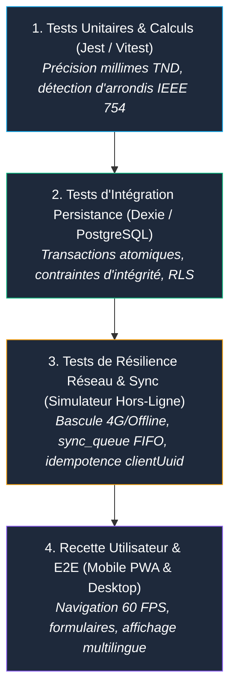

# 🧪 Stratégie de Test & Plan de Recette — SmartWallet

> **Matrice de Qualification Qualité, Scénarios aux Limites & Critères Go / No-Go**  
> **Version :** 2.0.0  
> **Périmètre :** Moteur Offline-First, Précision Financière, Synchronisation Cloud, Sécurité RLS

---

## 1. 🎯 Objectifs & Niveaux de Test

La stratégie qualité de SmartWallet garantit une fiabilité financière absolue en s'articulant sur 4 niveaux complémentaires :

---

## 2. 🔬 Matrice des Scénarios aux Limites (Edge Cases)

Cette matrice recense les cas critiques pouvant mettre en péril la cohérence financière ou l'expérience utilisateur.

| ID | Domaine / Scénario | Données en Entrée | Comportement Attendu | Validation |
| :--- | :--- | :--- | :--- | :--- |
| **TC-01** | **Transition Hors-Ligne vers En Ligne** | Enregistrement de 3 dépenses en mode Avion, puis réactivation du réseau. | Les 3 dépenses sont écrites dans `sync_queue`, affichées immédiatement en local, puis synchronisées séquentiellement (FIFO) avec Supabase sans perte. | `syncStatus` passe de `pending` à `synced` ; le compteur d'attente repasse à 0. |
| **TC-02** | **Prévention de Double Dépense (Rejeux Réseau)** | Interruption brutale de connexion pendant un POST HTTP, suivie de 3 rejeux automatiques. | Le serveur Postgres exécute `ON CONFLICT (id) DO UPDATE`. Une seule ligne de transaction existe dans `public.transactions`. | Aucun doublon dans la table distante ; le solde n'est débité qu'une seule fois. |
| **TC-03** | **Précision Extrême des Millimes (TND)** | Saisie de `0.001 DT`, `15.450 DT` et `999.999 DT`. Somme de 100 transactions à `0.003 DT`. | Aucun artefact d'arrondi binaire (pas de `0.30000000000000004 DT`). Affichage strict avec 3 décimales (`0,001 DT`). | `formatMoney()` renvoie exactement la chaîne attendue ; solde mathématiquement exact. |
| **TC-04** | **Solde Nul & Dépassement de Capacité** | Tentative de virement ou dépense de `100.000 DT` avec un solde actuel de `0.000 DT`. | Rejet immédiat par l'API avec code `400 Bad Request` et message `InsufficientBalanceException`. | L'opération est refusée ; le solde demeure `0.000 DT`. |
| **TC-05** | **Caractères Spéciaux & Injection dans les Libellés** | Libellé : ``, emojis `💸🍕`, quotes `' OR 1=1 --`. | Les caractères sont échappés ou stockés tels quels sans exécution XSS ni corruption SQL. | Affichage textuel verbatim sécurisé dans le tableau de bord. |
| **TC-06** | **Rupture Réseau Permanente (Cloud Indisponible)** | Supabase inaccessible ou mauvaises clés API. | L'application bascule silencieusement en mode Local-First. L'utilisateur peut continuer à saisir ses dépenses sans crash. | L'UI reste réactive et affiche l'indicateur "Mode Local". |
| **TC-07** | **Reconnexion après Longue Inactivité** | Reprise après 48h sans connexion et 25 transactions en attente. | `syncEngine` dépile les 25 éléments un par un dans l'ordre chronologique de création (`createdAt`). | Intégrité temporelle préservée dans l'historique cloud. |

---

## 3. 📋 Plan de Recette Fonctionnelle Pas-à-Pas

### Scénario Recette A : Parcours Onboarding & Initialisation
1. Lancer l'application (`http://localhost:5173`).
2. S'inscrire avec une nouvelle adresse email.
3. **Vérification :** Le compte est créé, le portefeuille reçoit le solde d'initialisation (`1000.000 DT` ou `1000.00 EUR`), et le tableau de bord s'ouvre sans erreur de console.

### Scénario Recette B : Test Nominal de Saisie de Dépense
1. Cliquer sur le bouton **"Nouvelle Transaction"** ou **"Ajouter Dépense"**.
2. Choisir la catégorie **"Alimentation"**, montant `12.500 DT`, description `Déjeuner`.
3. Valider le formulaire.
4. **Vérification :** 
   * Le modal se ferme instantanément.
   * Le solde affiché diminue de `12.500 DT`.
   * La nouvelle transaction apparaît en haut de la liste de l'historique.

### Scénario Recette C : Test Terrain Mode Hors-Ligne (PWA)
1. Ouvrir les Outils de Développement du navigateur (`F12`) > Onglet **Réseau** > Sélectionner **"Hors-ligne"** (Offline).
2. Saisir une dépense de `3.200 DT` (Café).
3. **Vérification :**
   * Aucun message d'erreur bloquant.
   * Le badge réseau passe en mode orange ("Hors-Ligne").
   * Le compteur affiche **"1 transaction en attente de synchronisation"**.
4. Repasser en **"En ligne"** (Online).
5. **Vérification :**
   * En moins de 2 secondes, le badge repasse en vert ("Synchronisé").
   * Le compteur repasse à 0.
   * L'entrée est persistée dans la base PostgreSQL distante.

---

## 4. 🚀 Checklist "Go / No-Go" Pré-Production

Avant tout déploiement final auprès des utilisateurs réels, valider l'ensemble des points d'arrêt suivants :

| Catégorie | Point de Contrôle | Statut Requis | Méthode de Validation |
| :--- | :--- | :--- | :--- |
| **Build** | Compilation frontend TypeScript / Vite sans warnings bloquants | **OBLIGATOIRE** | `npm run build` termine avec code `0` |
| **Build** | Compilation backend Maven / Spring Boot | **OBLIGATOIRE** | `./mvnw clean compile` termine avec succès |
| **Sécurité** | Politiques RLS actives sur toutes les tables Supabase | **OBLIGATOIRE** | `ALTER TABLE ... ENABLE ROW LEVEL SECURITY` vérifié |
| **Sécurité** | Clé `service_role` Supabase non exposée côté client | **OBLIGATOIRE** | Seule la clé publique `anon` figure dans le frontend |
| **Données** | Persistance IndexedDB opérationnelle hors-ligne | **OBLIGATOIRE** | Test de création en mode déconnecté réussi |
| **Monétaire** | Affichage à 3 décimales pour les devises à millimes (TND) | **OBLIGATOIRE** | Vérification visuelle sur les soldes et historiques |
| **Mobile** | Installation PWA fonctionnelle sur iOS Safari et Android Chrome | **OBLIGATOIRE** | Icône présente sur l'écran d'accueil et lancement plein écran |
| **i18n** | Textes traduits dans les 3 langues cibles (FR, EN, AR) | **OBLIGATOIRE** | Bascule de langue sans chaînes manquantes ou débordements |

> [!NOTE]
> Si un seul point de contrôle ci-dessus est en statut **ÉCHEC**, la décision de mise en production est **NO-GO**.
